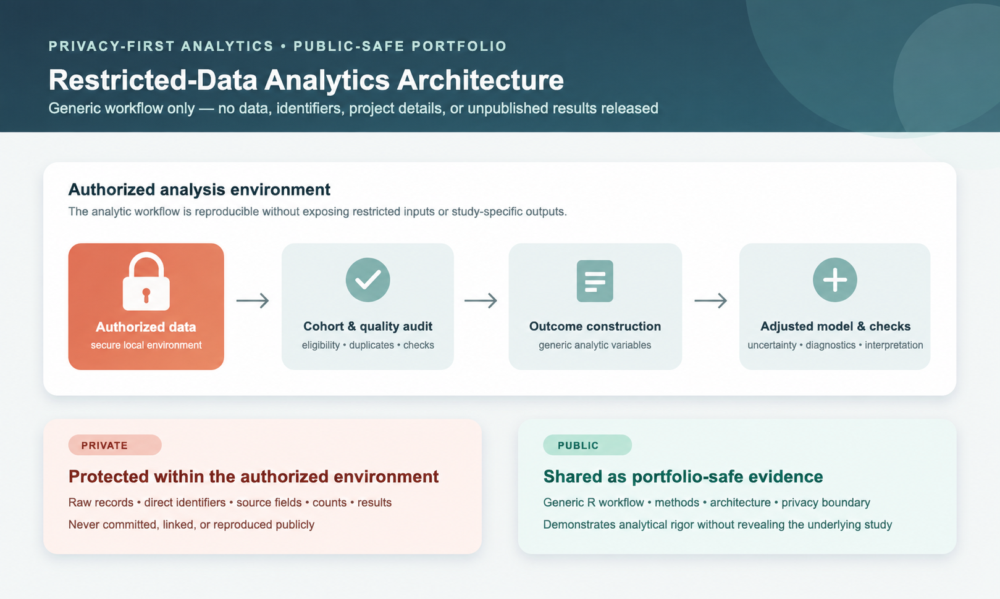

# Confidential Clinical Screening Analytics

**R · Data quality · Logistic regression · Privacy-aware analytics**

[← Back to Portfolio](https://github.com/ksitcode00)

> A fully anonymized portfolio project demonstrating an end-to-end analytical workflow for restricted clinical screening data. The public repository contains reusable R code, documentation, and workflow visuals only. It intentionally contains no organization, location, study name, sample size, health-condition results, data files, or unpublished findings.

<p align="center">
  
</p>

## Executive Summary

This project shows how I approach a restricted-data analytics workflow: audit records, construct analysis-ready outcomes, quantify uncertainty, fit and check an adjusted model, and communicate methods clearly. The code is intentionally written with generic variable names so it can demonstrate the workflow without revealing the underlying study.

## My Role

- Cleaned and harmonized restricted screening and examination data in R.
- Applied cohort eligibility checks, de-duplication, and denominator audits.
- Constructed analysis outcomes by reconciling screening and reported-history fields.
- Reproduced descriptive summaries with exact confidence intervals.
- Built, diagnosed, and communicated adjusted logistic-regression analyses.

## Quick Review

| Analytical need | Public-safe implementation |
| --- | --- |
| Build a reliable cohort | Eligibility filters, deduplication, and integrity checks in [`01_cohort_audit.R`](R/01_cohort_audit.R) |
| Create interpretable outcomes | Generic screening/history comparison in [`02_screening_outcomes.R`](R/02_screening_outcomes.R) |
| Estimate adjusted associations | Complete-case logistic-regression workflow in [`03_regression_models.R`](R/03_regression_models.R) |
| Keep restricted information private | Inputs and outputs excluded through the [privacy note](docs/data_privacy.md) |

## Analysis Walkthrough

### 1. Validate the analysis cohort

```r
analytic_cohort <- study_data |>
  filter(screening_setting %in% eligible_settings) |>
  distinct(record_id, .keep_all = TRUE)

stopifnot(!anyDuplicated(analytic_cohort$record_id))
```

### 2. Construct screening outcomes

```r
screening_outcomes <- analytic_cohort |>
  mutate(
    exam_positive = any_true(exam_indicator_a, exam_indicator_b, exam_indicator_c),
    history_positive = any_true(history_indicator_a, history_indicator_b, history_indicator_c),
    previously_unreported = exam_positive & !history_positive
  )
```

### 3. Estimate adjusted associations

```r
fit <- glm(
  previously_unreported ~ age_group + sex + demographic_group + coverage_status + area_context_quartile,
  data = model_data,
  family = binomial()
)

odds_ratios <- broom::tidy(fit, conf.int = TRUE, exponentiate = TRUE)
```

## Technical Approach

- **Data quality:** cohort construction, duplicate checks, and denominator reconciliation.
- **Outcome construction:** generic comparison of screening/examination and reported-history fields.
- **Uncertainty:** exact binomial confidence intervals for descriptive summaries.
- **Modeling:** complete-case logistic regression, odds-ratio extraction, and diagnostic workflow.
- **Privacy:** no data, counts, organizations, locations, results, or internal materials are committed.

## Analytical Tradeoffs

- This is an observational screening workflow, so adjusted associations are not causal effects.
- Complete-case models offer consistent covariates but can differ from descriptive samples.
- Public code demonstrates process rather than releasing protected results.

## Privacy and Reproducibility

The public project contains generalized code only. Restricted inputs and generated analytical outputs remain outside Git. See:

- [Data access](data/README.md)
- [Data privacy](docs/data_privacy.md)
- [Methodology](docs/methodology.md)
- [Reproducibility](docs/reproducibility.md)
- [R pipeline](R/README.md)

## Project Structure

```text
confidential-clinical-screening-analysis/
├── analysis/       # Public-safe R Markdown walkthrough
├── R/              # Cohort, outcome, model, and visualization scripts
├── data/           # Access statement only; no data
├── docs/           # Generic method, privacy, and reproduction notes
└── figures/        # Workflow visual only
```

## Tools

`R` · `R Markdown` · `dplyr` · `readxl` · `ggplot2` · `Logistic regression` · `Exact binomial confidence intervals`
